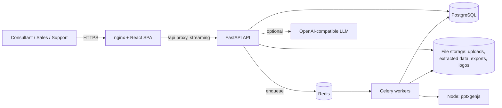
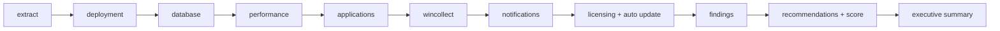

# Architecture

## System context

## Processing pipeline

An upload is a resumable chunked transfer (`POST /api/uploads` → `PUT …?offset=` → `/complete`). Creating an assessment enqueues the job. Each stage persists its output and a checkpoint (`job_stages`), so a failed or interrupted job resumes from the first unfinished stage.

| Stage | Responsibility | Code |
|---|---|---|
| extract | hardened streaming extraction, classification, manifest | `app/ingestion/` |
| deployment | `deployment.xml`, hostcontext, masterlist, tunnels | `app/parsers/deployment.py`, `app/analysis/deployment.py` |
| database | PostgreSQL dump (COPY format) tables: `notification_view`, managed hosts, log sources, WinCollect, applications, licences | `app/parsers/tables.py`, `domain.py` |
| performance | SAR, `df`, `free`, `top`, `ps`, `iostat` per host | `app/parsers/sar.py`, `system.py`, `app/analysis/performance.py` |
| applications / wincollect / notifications / licensing | domain analysis | `app/analysis/` |
| findings | rule-based detections → knowledge-base mapping | `app/analysis/findings.py`, `kb.py` |
| recommendations | category scoring, risk, maturity | `app/analysis/scoring.py` |
| summary | executive narrative and top-10 recommendations | `app/reports/model.py` |

Runner and recovery logic live in `app/pipeline/runner.py`; dispatch (`inline` thread pool vs. Celery) in `dispatch.py` / `celery_app.py`.

## Ingestion security model

`app/ingestion/safe_extract.py` is a single-pass streaming extractor. It never trusts archive metadata:

* rejects absolute paths, `..` traversal, NUL bytes, over-long paths and duplicate members (Zip Slip, path traversal);
* rejects symlinks, hardlinks and device/special entries;
* verifies magic bytes against the declared extension (extension spoofing);
* enforces limits on file count, per-member size, total extracted size, compression ratio and nested-archive depth (decompression bombs);
* **extracts selectively**: only members relevant to the health check (see `classify.py`) are materialised, the rest are catalogued in a manifest. This is what makes >10 GB bundles feasible in one pass.

Violations raise `ArchiveSecurityError` and fail the job with a clear message.

## Scoring

Seven categories with weights: performance 22 %, deployment 18 %, log sources 16 %, notifications 14 %, licensing 14 %, applications 8 %, WinCollect 8 %.

* **Category score** – each open finding (not `resolved` / `dismissed`) carries a penalty by severity (critical 25, high 14, medium 6, low 2). Findings are sorted by severity and each further finding weighs 10 % less than the previous one, so one noisy source cannot zero a category. The score is `100 · exp(−penalty / 60)`, a saturating curve (one critical ≈ 66, one high ≈ 79, one medium ≈ 90).
* **Overall score** – weighted mean of the categories that have data in the bundle. Any critical finding caps the score at 89, and each additional critical lowers the ceiling by 3 (down to a 65 floor on the cap).
* **Risk score** – severity-weighted finding counts (critical 10, high 6, medium 3, low 1; ×0.8 when a severity has more than 5) plus 35 % of the distance to 100 from the overall score, capped at 100. Levels: Low < 30, Medium < 55, High < 75, Critical ≥ 75.
* **Maturity** – Initial, Developing (≥ 45), Defined (≥ 62), Managed (≥ 78), Optimised (≥ 90), derived from the overall score.
* **Grade** – A ≥ 90, B ≥ 80, C ≥ 70, D ≥ 55, otherwise F.

Changing a finding’s status or severity re-runs scoring. See `app/analysis/scoring.py`.

## Knowledge base

`app/analysis/kb.py` holds 40 QRadar-specific entries. Every finding is matched to an entry and inherits: description, impact, business impact, risk, recommendation steps, IBM best practice and priority. Editing the KB changes all future assessments.

## Data model

`users`, `uploads`, `assessments`, `job_stages`, `assessment_data` (JSON documents per analysis section), `findings`, `comments`, `report_configs`, `exports`, `chat_messages`, `audit_log`. JSON columns are `JSONB` on PostgreSQL. Schema is managed by Alembic (`backend/alembic/versions/0001_initial_schema.py`); a test asserts models and migrations do not drift.

## API surface (all under `/api`)

| Group | Endpoints |
|---|---|
| auth / users | `POST /auth/login`, `GET /auth/me`, `/users` (admin), `/audit` |
| uploads | `POST /uploads`, `PUT /uploads/{id}?offset=`, `GET /uploads/{id}`, `POST /uploads/{id}/complete`, `POST /uploads/direct` |
| assessments | `POST/GET /assessments`, `GET/PATCH/DELETE /assessments/{id}`, `POST …/resume` |
| analysis data | `…/overview`, `deployment`, `logsources-analysis`, `licensing`, `performance`, `health`, `notifications`, `applications`, `findings` |
| consultant input | `PUT …/comments/{type}/{key}`, `PATCH …/findings/{id}`, `PUT …/report-config`, `POST/GET …/logo` |
| assistant | `GET/POST/DELETE …/assistant` |
| exports | `POST …/exports/{pdf\|docx\|pptx}`, `GET …/exports`, `GET /exports/{id}/download` |
| reference | `GET /knowledge-base`, `GET /health` |

Interactive docs: `/api/docs`.

## AI assistant

`app/assistant/engine.py` classifies the question into an intent (`why_score_low`, `critical`, `fix_first`, `eps_high`, `explain_notification`, `license`, `wincollect`, `logsources`, `applications`, `performance`, `deployment`, `environment`, `general`) and answers deterministically from the stored assessment, so every answer is traceable to findings. If `QHC_LLM_BASE_URL` and `QHC_LLM_API_KEY` are configured, the grounded draft answer, the overall score, the top 15 findings (severity, priority, title, observation) and the last few chat turns are sent to that endpoint to improve phrasing; if the call fails, the deterministic answer is returned. **This transmits assessment-derived data (which can include hostnames) to the configured service**, so use an approved endpoint. Without it, nothing leaves the deployment.

## Reports

`app/reports/model.py` builds one report model used by every exporter, so PDF, DOCX and PPTX are consistent. PDF uses reportlab with matplotlib charts; DOCX uses python-docx (editable, with tables and embedded charts); PPTX is generated by `pptx_gen/generate.js` (pptxgenjs) from a JSON model passed by the API. Each export is stored, listed, audited and downloadable again.

## Frontend

React 19 + TypeScript + Vite. Redux Toolkit holds auth and UI state; TanStack Query owns server state (with polling while jobs run); React Hook Form + Zod validate forms; Recharts, D3 (treemap) and React Flow render visuals; Framer Motion handles transitions; Tailwind with CSS-variable themes provides dark (default) and light modes. Pages are lazy-loaded. Permissions in `store/auth.ts` mirror the backend and are used only to hide controls; the API enforces them.

## Reliability

* `acks_late` + `reject_on_worker_lost`: a lost worker’s job is redelivered.
* Stage checkpoints make resume cheap; extraction is idempotent.
* Stale *processing* jobs are re-queued at API and worker start-up.
* Upload offsets are authoritative on the server; clients resynchronise on `409` and retry transient failures with back-off.
* Parser failures degrade to warnings (assessment becomes *partial*) rather than aborting unrelated sections.

## Known limitations

* Parsers were validated against synthetic bundles; real-world layout differences between QRadar versions are the main risk (see README).
* Findings are rule-based; thresholds are conservative defaults in `app/analysis/` and should be tuned with field data.
* The optional LLM path is a thin phrasing layer and is not evaluated here.
* Download tokens in query strings can appear in proxy logs.
